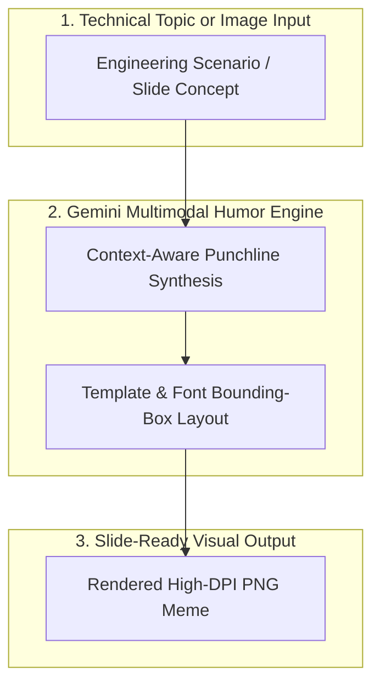

# 🎬 Ultimate Meme Generator


> **Author & Architect:** [Robina Mirbahar](https://github.com/RobinaMirbahar) (Google Developer Expert in Cloud & AI)  
> **Focus:** Context-Aware Tech & Cloud Engineering Meme Studio Powered by Python & Google Gemini Multimodal API

---

## 🎯 Why I Built AI Developer Meme Generator (Engineering Purpose & Real-World Value)

### 1. 😄 Making Complex Cloud & AI Talks Memorable
Technical presentations on Kubernetes, IAM permissions, or LLM hallucinations land 10x better with sharp, relatable engineering humor. I built this AI Meme Generator to craft context-aware developer memes automatically.

### 2. 🖼️ Multimodal Vision + Dynamic Typography
I wired Google Gemini's multimodal reasoning with automated image composition so captions fit template layouts cleanly.

### 3. 🚀 Fast CLI & Web Workflow for Speakers
Give the generator a technical topic (e.g., *'Cloud Run scale-to-zero vs idle VMs'*) and it produces slide-ready visual punchlines in seconds.

---

## 🏗️ System Architecture



---

Welcome to the **Ultimate Meme Generator**! This app allows you to create custom memes with AI-generated images and professional text overlays. You can also add animation effects to make your memes even more entertaining.

## Features

- **AI-Generated Images**: Generate images from text prompts using Google Cloud's Vertex AI.
- **Customizable Text**: Add meme text with custom font, color, and position.
- **Animation Effects**: Add animations like fade-in, slide-up, and typing effect.
- **Static and Animated Outputs**: Generate both static memes and animated GIFs.
- **Download**: Easily download your meme as a JPEG image or a GIF.

## How It Works

1. **Describe Your Image**: Provide a detailed text description of the image you want to create. The more specific you are, the better the result!
2. **Customize Appearance**: Choose the art style for your image, such as photorealistic, cartoon, digital art, etc.
3. **Add Meme Text**: Customize the meme text, its position, color, and outline.
4. **Animation Options**: Apply animation effects to your meme. Choose between no animation, fade-in, slide-up, or typing effects.
5. **Generate**: Click "Generate Meme" and wait for the magic to happen! Your meme will be generated in a few seconds, and you can download it afterward.

## Installation

To run this app locally, you'll need Python 3.7+ and several dependencies. Follow the steps below to get started:

### 1. Clone the Repository

```bash
git clone https://github.com/yourusername/meme-generator.git
cd meme-generator
```

### 2. Install Dependencies

Create a `requirements.txt` file to install all necessary dependencies. The following libraries are required:

```txt
streamlit==1.18.0
google-generativeai==0.1.0
Pillow==9.0.1
requests==2.27.1
google-auth==2.6.6
google-auth-oauthlib==0.4.6
google-auth-httplib2==0.1.0
```

Install them with the following command:

```bash
pip install -r requirements.txt
```

### 3. Setup Google Cloud Credentials

To use the AI features, you'll need to set up your Google Cloud credentials:

- Create a Google Cloud project.
- Enable the Vertex AI API.
- Download the service account key JSON file.
- Store your credentials in the `.streamlit/secrets.toml` file like so:

```toml
[gcp]
project_id = "your-gcp-project-id"
credentials = """{
    "type": "service_account",
    "project_id": "your-gcp-project-id",
    "private_key_id": "your-private-key-id",
    "private_key": "your-private-key",
    "client_email": "your-client-email@your-gcp-project-id.iam.gserviceaccount.com",
    "client_id": "your-client-id",
    "auth_uri": "https://accounts.google.com/o/oauth2/auth",
    "token_uri": "https://oauth2.googleapis.com/token",
    "auth_provider_x509_cert_url": "https://www.googleapis.com/oauth2/v1/certs",
    "client_x509_cert_url": "your-client-x509-cert-url"
}"""
```

### 4. Run the App

Start the app by running the following command:

```bash
streamlit run app.py
```

Your meme generator will be accessible at `http://localhost:8501`.

## Usage

### 1. **Describe the Image**
   - Enter a detailed description of the image you want to create (e.g., "a surprised cat looking at a cucumber").

### 2. **Customize the Appearance**
   - Select an art style (e.g., photorealistic, cartoon, digital art, etc.).
   
### 3. **Add Text**
   - Enter your meme text (e.g., "WHEN YOU SEE IT").
   - Choose the position for the text (top, center, or bottom).
   - Pick the text color and outline color.

### 4. **Add Animation (Optional)**
   - Choose an animation effect (e.g., fade-in, slide-up, typing effect).
   
### 5. **Generate the Meme**
   - Click the "✨ Generate Meme ✨" button to create your meme. It may take 20-40 seconds for the meme to be generated.
   
### 6. **Download**
   - Once generated, you can download the meme as a JPEG image or an animated GIF.

## Development

### Requirements

- **Python 3.7+**
- **Streamlit**: For building the web app.
- **Google Cloud Client**: For using Vertex AI to generate images.
- **Pillow**: For image processing and adding text overlays.
- **requests**: For downloading the necessary assets like the Impact font (if not already available).
- **google-auth**, **google-auth-oauthlib**, **google-auth-httplib2**: Required for GCP authentication.

To install the required dependencies, run:

```bash
pip install -r requirements.txt
```

### Customizing the Art Style

You can modify the list of art styles in the `app.py` file to add or remove options for meme generation.

### Modifying Animation Effects

To add new animation effects, you can extend the logic in the `add_meme_text` function in the `utils/meme_creation.py` file.

## Contributing

If you'd like to contribute to the project, feel free to fork the repository and submit a pull request! Any improvements, bug fixes, or new features are welcome.

1. Fork the repository.
2. Create a new branch (`git checkout -b feature-branch`).
3. Make your changes and commit them (`git commit -m 'Add new feature'`).
4. Push to your forked repository (`git push origin feature-branch`).
5. Submit a pull request.

## License

This project is licensed under the MIT License - see the [LICENSE](LICENSE) file for details.

## Acknowledgments

- **Google Cloud** for providing the Vertex AI API for image generation.
- **Streamlit** for making it easy to build interactive apps.
- **Pillow** for handling image manipulation and adding text overlays.
- **Requests** for downloading the necessary assets like the Impact font.

---


---

### 🚀 Featured Google Cloud & Agentic AI Portfolio by Robina Mirbahar

| Repository | Architecture & Focus | Live Status |
| :--- | :--- | :--- |
| **[gemma4-multilora-adk-eval](https://github.com/RobinaMirbahar/gemma4-multilora-adk-eval)** | Dynamic Multi-LoRA Hot-Swapping & CI/CD Agent Evaluation (`adk eval`) on Cloud Run GPUs with Gemma 4 & vLLM |   |
| **[slothsre-napops](https://github.com/RobinaMirbahar/slothsre-napops)** | SlothSRE ("NapOps") — Overnight Gemma 4 & Google ADK Incident Digest Agent with OpenTelemetry & Sentry AI Monitoring |   |
| **[streamforge-event-adk](https://github.com/RobinaMirbahar/streamforge-event-adk)** | Real-Time Event-Driven Multi-Agent Pipelines on Google Cloud with ADK (`ParallelAgent` & `LoopAgent`), Eventarc & Pub/Sub |   |
| **[a2a-mcp-mesh-cloudrun](https://github.com/RobinaMirbahar/a2a-mcp-mesh-cloudrun)** | Agent-to-Agent (A2A) & Multi-MCP Mesh on Cloud Run with Gemma 4, Google ADK, Spanner Graph & AlloyDB |   |
| **[cloudguard-gemma-agent](https://github.com/RobinaMirbahar/cloudguard-gemma-agent)** | 6-Part Production Gemma Enterprise Agent Series (ADK, Cloud Run L4 GPU, Firestore, Model Armor, Vertex AI QLoRA) |   |
| **[Comic-Studio-Ai](https://github.com/RobinaMirbahar/Comic-Studio-Ai)** | Multi-Agent Comic Generator powered by Google Gemini API & FastAPI deployed on Google Cloud Run |   |
| **[vertex-ai-imagen3](https://github.com/RobinaMirbahar/vertex-ai-imagen3)** | Generate AI-powered product & editorial images using Google Vertex AI Imagen 3 in Google Colab |   |
| **[Python-Learning-Assistant](https://github.com/RobinaMirbahar/Python-Learning-Assistant)** | AI-powered Python tutor covering 50+ interactive exercises with real-time feedback built with Streamlit + Gemini API |   |
| **[cozy-ai-agent-cafe-game](https://github.com/RobinaMirbahar/cozy-ai-agent-cafe-game)** | Prompt Paws: 60 FPS Cozy AI Agent Bakery Simulation Game teaching RAG, Guardrails, Context Caching & Multi-Agent Loops |   |

<div align="center">
  
</div>

<!-- AUTHOR_SIGNATURE_START -->
---

## 👩‍💻 About the Author

**Robina Mirbahar — Google Cloud & AI Architect**  
*Google Developer Expert (GDE) in Cloud & AI • Published Author • Multi-Agent Systems & Serverless GPU Builder*

[](https://github.com/RobinaMirbahar)
[](https://medium.com/@robinamirbahar)
[](https://dev.to/robinamirbahar)
[](https://www.linkedin.com/in/robina-mirbahar)
[](https://g.dev/RobinaMirbahar)
[](https://www.youtube.com/@RobinaMirbahar)
[](https://x.com/RobinaMirbahar)
[](https://www.amazon.com/dp/B0D146249R)

<!-- AUTHOR_SIGNATURE_END -->
